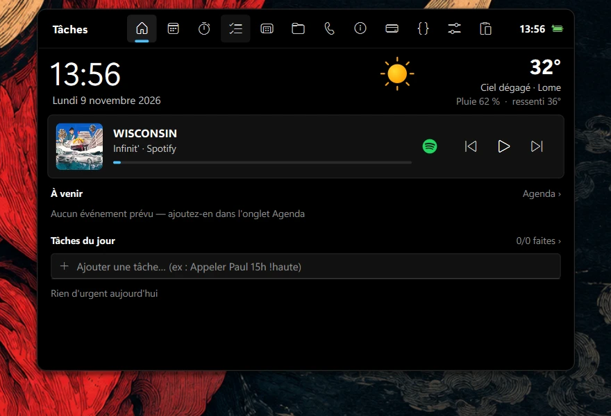
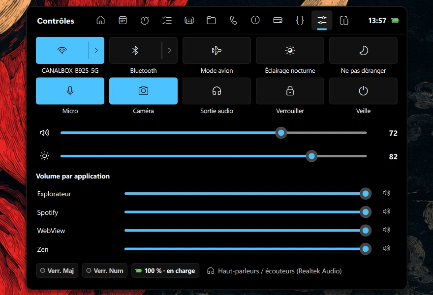
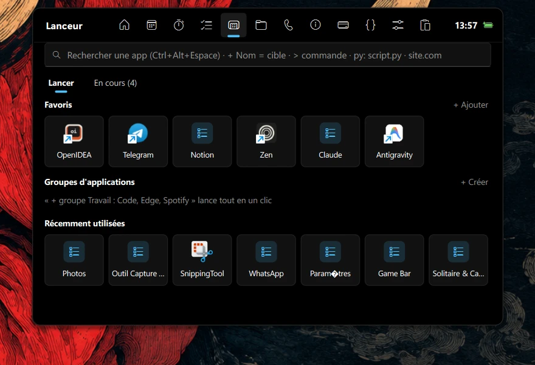
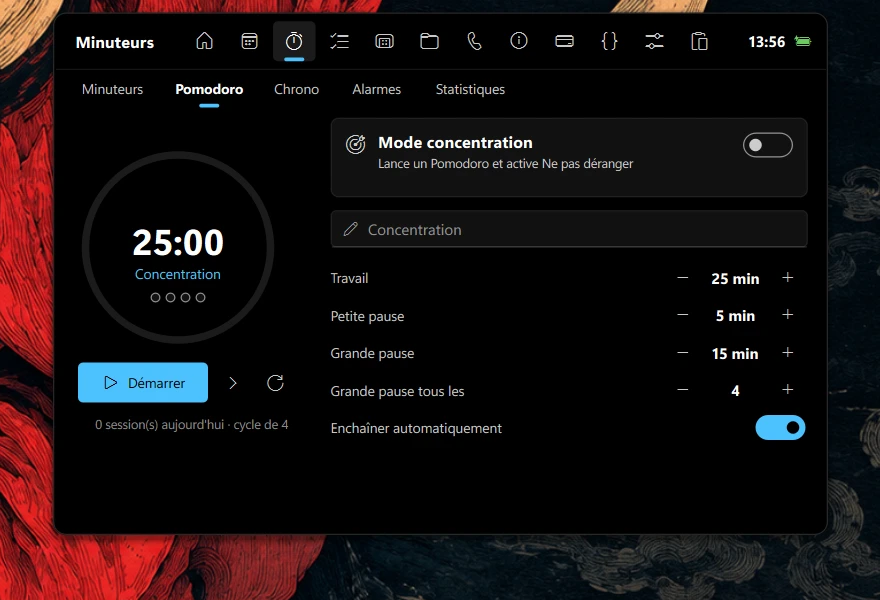
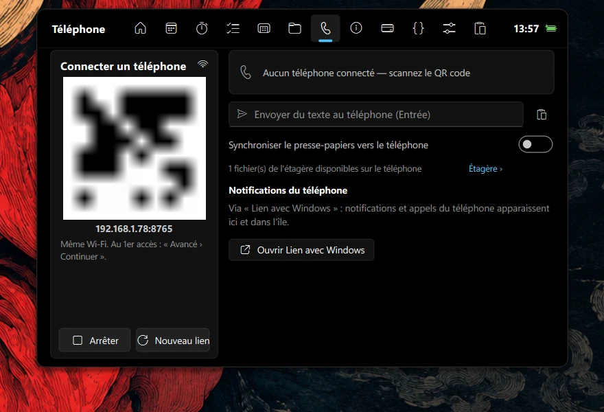

# Dynamic Island pour Windows 11

Une île flottante **noire** en haut de l'écran, inspirée de la Dynamic Island de l'iPhone et dessinée
au style **Windows 11** (coins de 9-10 px, couleur d'accentuation de Windows, icônes Fluent).
Elle remplace la barre des tâches : heure, média, notifications, réglages rapides, lanceur
d'applications, fichiers, téléphone… tout est dans l'île.

Écrite en Python avec **PySide6** (Qt), sans dépendance à un service en ligne obligatoire.

<p align="center">
  <br>
  <em>Fermée, l'île affiche l'essentiel (ici, la musique en cours)</em>
</p>

## Aperçu

| Accueil | Contrôles |
|---|---|
|  |  |
| **Lanceur** | **Minuteurs** |
|  |  |
| **Téléphone** | |
|  | |

---

## Fonctionnement général

| Geste | Effet |
|---|---|
| Survol | ouvre l'île (animation fluide à ressort) |
| Clic sur la pilule | la garde ouverte · clic ailleurs ou `Échap` la referme |
| Clic droit | menu : garder ouvert, démarrage avec Windows, barre des tâches, synchronisation, quitter |
| Molette sur la pilule fermée | volume |
| `Ctrl+Alt+V` | presse-papiers avec recherche |
| `Ctrl+Alt+Espace` | lanceur d'applications |
| Glisser des fichiers sur l'île | ils restent en attente sur l'étagère |

**Pilule fermée** : selon le contexte, elle affiche l'heure, le minuteur en cours, une réunion imminente,
la musique en lecture ou un build en cours. Points vert / orange : caméra / micro utilisés.

**Notifications de l'île** : volume, changement de morceau, sortie audio, batterie, Verr. Maj,
fin de minuteur, rappels, CI en échec, fichier reçu du téléphone, appel entrant…

**Toujours présente** : l'île reste au-dessus de tout (même en plein écran), démarre avec Windows et un
gardien (`island_watchdog.pyw`) la relance si elle plante.

**Barre des tâches masquée en permanence**, même au survol. La touche Windows ouvre toujours le menu
Démarrer. Pour la retrouver : clic droit sur l'île › décocher *Masquer la barre des tâches*, ou *Quitter*
(elle revient comme avant). Si l'île plante plusieurs fois de suite, le gardien réaffiche la barre.

---

## Onglets

| Onglet | Contenu |
|---|---|
| **Accueil** | Heure, date, météo, lecteur multimédia (bouton pour **ouvrir l'appli qui joue** : Spotify, navigateur…), prochains événements avec bouton *Rejoindre*, anniversaires, tâches du jour, minuteurs actifs |
| **Agenda** | À venir · Semaine · Mois · Comptes. Ajout rapide en français (« Réunion demain 14h30 », « Anniversaire Léa 12/03 »), modification, suppression, rappels, compte à rebours, liens Teams / Zoom / Meet détectés |
| **Minuteurs** | Minuteurs multiples (« 12m thé »), Pomodoro avec pauses, mode concentration (active *Ne pas déranger*), chronomètre avec tours, alarmes (« 7h30 Réveil semaine »), statistiques et historique |
| **Tâches** | Aujourd'hui · Toutes · Projets · Notes. « Envoyer devis demain 9h !haute #client » crée une tâche avec échéance, rappel, priorité et projet. Notes rapides épinglables, recherche |
| **Lanceur** | *Lancer* : recherche d'applications (menu Démarrer + Microsoft Store), favoris, groupes lancés en un clic, applis récemment utilisées. *En cours* : applications ouvertes avec leurs fenêtres et leur mémoire — afficher, réduire, fermer, forcer l'arrêt |
| **Fichiers** | Étagère (ouvrir, copier / déplacer vers…, presse-papiers, glisser vers une autre appli), téléchargements en cours (pourcentage et temps restant pour Chrome / Edge / Brave), fichiers récents, dossiers favoris, raccourcis sur le Bureau |
| **Téléphone** | QR code → page web sur le téléphone (même Wi-Fi, HTTPS local, lien secret) : fichiers PC ⇄ téléphone, texte et presse-papiers dans les deux sens, télécommande, batterie. Notifications et appels via *Lien avec Windows*. QR code du Wi-Fi |
| **Infos** | Widgets personnalisables : météo et prévisions, heure mondiale, statistiques, citation du jour, actualités RSS, bourse, photo favorite, calendrier |
| **Finances** | Portefeuille **Binance** en lecture seule (Spot, Financement, Earn), en $ / FCFA / €, variation 24 h, historique, mode masqué |
| **Dev** | IDE et projet ouverts (VS Code, IntelliJ, PyCharm, Visual Studio…), branche et statut Git, commits, GitHub (PR, issues, CI, déploiements, notifications), Jenkins, build local et erreurs, logs, serveurs et ports locaux, services, projets favoris |
| **Contrôles** | Réglages rapides façon Windows 11 : **Wi-Fi**, **Bluetooth** et **point d'accès mobile** (le chevron `›` ouvre un panneau détaillé), appareils du réseau, mode avion, éclairage nocturne, Ne pas déranger, micro, caméra, sortie audio, verrouiller, veille, volume général et par appli, luminosité |
| **Presse-papiers** | Historique des textes, liens, images et fichiers, recherche, catégories, épingler, coller directement dans l'appli active |

### Panneaux Wi-Fi, Bluetooth, point d'accès et réseau
- **Wi-Fi** : réseaux visibles avec force du signal et sécurité, réseau connecté en tête.
  Connexion en un clic aux réseaux enregistrés ou ouverts, saisie du mot de passe pour un nouveau réseau
  (WPA2 / WPA3), déconnexion, oubli d'un réseau (double confirmation).
- **Bluetooth** : appareils appairés avec leur état. Connexion / déconnexion des casques et enceintes en un clic.
  *Ajouter un appareil* ouvre l'appairage de Windows.
- **Point d'accès mobile** : activation / arrêt du partage de connexion de Windows, nom, mot de passe
  (affichable, modifiable ou généré), bande (automatique, 2,4 GHz, 5 GHz), QR code pour connecter un appareil,
  liste des appareils connectés (nom, adresse IP, adresse MAC).
  **Bloquer** un appareil : Windows ne permet pas d'éjecter un appareil précis, l'île change donc le mot de passe
  et redémarre le point d'accès ; les autres appareils se reconnectent avec le nouveau mot de passe (QR code).
  Un appareil bloqué qui revient est signalé.
- **Appareils réseau** : appareils présents sur le Wi-Fi actuel (box / routeur, cet ordinateur, autres appareils
  avec IP, MAC et nom). Le blocage sur ce réseau se fait dans l'administration du routeur (bouton *Administrer*).

> Certaines cartes Wi-Fi ne peuvent pas créer de point d'accès quand leur Wi-Fi Direct est déjà utilisé
> (Lien avec Windows, partage de proximité, projection) : l'île affiche alors la cause.

---

## Connexions facultatives

- **Google Agenda / Outlook / Teams** : Agenda › Comptes › coller l'adresse iCal secrète.
- **GitHub** : Dev › GitHub › coller un jeton personnel (notifications et dépôts privés). Sans jeton, les dépôts publics fonctionnent.
- **Jenkins** : Dev › Builds › « URL utilisateur jeton ».
- **Binance** : Finances › clé API **en lecture seule** puis clé secrète.
- **Téléphone** : Téléphone › Activer › scanner le QR. Au premier accès, le navigateur avertit (certificat local) :
  « Paramètres avancés › Continuer ». Windows peut demander d'autoriser Python sur le réseau privé.
- **Synchronisation cloud** : clic droit › *Synchroniser via un dossier cloud…* (OneDrive, Google Drive, Dropbox) :
  tâches, notes, agenda local, alarmes, sessions et presse-papiers partagés entre plusieurs PC.
- **Météo** : position estimée via l'adresse IP (ipwho.is), données Open-Meteo ; ville modifiable dans Infos › Modifier.

## Données et confidentialité

Tout est stocké localement dans `%APPDATA%\DynamicIsland` (ou dans le dossier de synchronisation choisi) :
réglages, clés API, historique du presse-papiers, certificat du serveur téléphone. Rien de tout cela n'est
dans ce dépôt. Les clés (GitHub, Binance) y sont en clair : utilisez des clés à droits limités.

---

## Installation

Prérequis : **Windows 11** et **Python 3.12**.

```bash
git clone https://github.com/arielDirema/dynamic-island.git
cd dynamic-island
python -m venv .venv
.venv\Scripts\python -m pip install -r requirements.txt
```

Lancer : double-clic sur `start.bat` (il démarre le gardien, qui démarre l'île). Le démarrage avec Windows
est activé au premier lancement (désactivable par clic droit sur l'île).

## Structure du code

| Fichier | Rôle |
|---|---|
| `island.py` | fenêtre, animation, pilule, notifications, saisie, menu, démarrage |
| `island_watchdog.pyw` | gardien : relance l'île en cas de plantage |
| `ui.py`, `theme.py`, `icons.py` | composants Windows 11 dessinés, thème, icônes vectorielles |
| `tab_*.py` | un fichier par onglet |
| `system.py` | audio, luminosité, radios, Ne pas déranger, barre des tâches, fenêtres |
| `network.py` | réseaux Wi-Fi et appareils Bluetooth |
| `hotspot.py` | point d'accès mobile et appareils du réseau local |
| `media.py` | média en lecture (contrôles multimédias de Windows) |
| `agenda.py`, `timers.py`, `tasks.py`, `nlp.py` | agenda, minuteurs, tâches, saisie en français |
| `launcher.py`, `files.py`, `clipboard.py` | lanceur, fichiers, presse-papiers |
| `phone.py`, `phone_page.html` | serveur local et page web du téléphone |
| `infos.py`, `binance.py`, `devtools.py` | widgets, Binance, espace développeur |
| `store.py` | stockage local et synchronisation |
